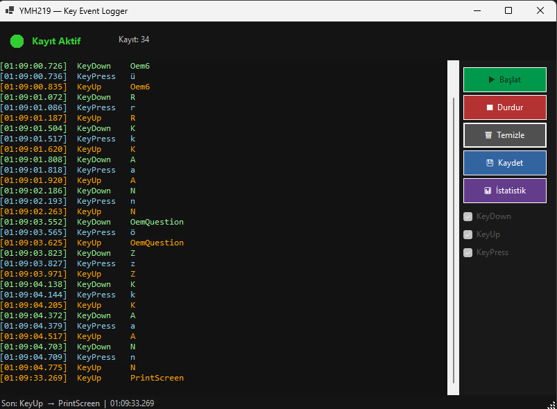
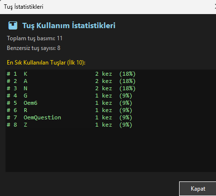

# YMH219 — Key Event Logger

> **Nesne Tabanlı Programlama (YMH 219) · Ek Uygulama Ödevi #2**  
> Ortam: Visual Studio 2022 · C# · .NET 6 · Windows Forms

---

## 📌 Proje Açıklaması

**Key Event Logger**, Windows Forms ile geliştirilmiş eğitsel bir klavye olayı izleme uygulamasıdır.  
Uygulama **yalnızca kendi penceresi odaktayken** klavye olaylarını (KeyDown / KeyUp / KeyPress) yakalar, listeler ve isteğe bağlı olarak `.txt` dosyasına kaydeder.

> ⚠️ **Güvenlik Notu:** Bu uygulama gerçek bir sistem keylogger'ı **değildir**.  
> Global hook, arka plan çalışması veya ağ üzerinden veri gönderme kesinlikle yapılmamaktadır.

---

## 🛠 Kullanılan Teknolojiler

| Teknoloji | Versiyon |
|---|---|
| C# / .NET | 6.0 (net6.0-windows) |
| Windows Forms | .NET 6 built-in |
| Visual Studio | 2022+ |

---

## ⚙️ Kurulum ve Çalıştırma

### Gereksinimler
- .NET 6 SDK veya üzeri
- Windows 10 / 11
- Visual Studio 2022 (veya `dotnet` CLI)

### Visual Studio ile
1. `YMH219-KeyEventLogger.sln` dosyasını Visual Studio'da açın.
2. **Build → Build Solution** (`Ctrl+Shift+B`)
3. **F5** ile çalıştırın.

### dotnet CLI ile
```bash
cd YMH219-KeyEventLogger
dotnet build
dotnet run --project YMH219-KeyEventLogger
```

---

## 🎯 Uygulamanın Temel Özellikleri

| Özellik | Açıklama |
|---|---|
| **Başlat / Durdur** | Kayıt oturumunu başlatır ya da durdurur |
| **Renk Kodlaması** | KeyDown=Yeşil · KeyUp=Turuncu · KeyPress=Mavi |
| **Durum Göstergesi** | Yeşil/gri daire + etiket ile kayıt durumu anlık görünür |
| **Temizle** | Ekrandaki tüm kayıtları siler (onay diyaloğu ile) |
| **Kaydet (.txt)** | Kayıtları zaman damgalı dosyaya aktarır |
| **İstatistik Penceresi** | En sık kullanılan 10 tuş ve yüzde dağılımı |
| **Olay Tipi Filtresi** | KeyDown / KeyUp / KeyPress checkbox ile ayrı ayrı filtre |
| **Maksimum Kayıt Sınırı** | 5000 kayıt dolunca en eski otomatik silinir (bellek dostu) |
| **Modifier Desteği** | Ctrl, Alt, Shift kombinasyonları ayrıca gösterilir |
| **Milisaniye Zaman Damgası** | Her olay `HH:mm:ss.fff` hassasiyetinde kaydedilir |

---

## 🏗 Nesne Tabanlı Tasarım

```
YMH219-KeyEventLogger/
├── Program.cs          → Uygulama giriş noktası (STAThread)
├── MainForm.cs         → Ana form; klavye olayları & UI yönetimi
├── KeyLogger.cs        → İş mantığı sınıfı; kayıt, istatistik, dosyaya yazma
├── KeyLogEntry.cs      → Veri modeli; tek bir klavye olayını temsil eder
└── StatsForm.cs        → İstatistik formu (top-10 tuş gösterimi)
```

**Temel OOP Prensipleri:**
- **SRP** — Her sınıf tek bir sorumluluğa sahip
- **Encapsulation** — `KeyLogger` iç listesini `IReadOnlyList` ile dışarıya açar
- **Event-Driven** — `EntryAdded` event'i ile UI'dan bağımsız bildirim
- **Hata Yönetimi** — Dosya kayıt hataları kullanıcıya iletilir, uygulama çökmez

---

## 📸 Ekran Görüntüleri

### Ana Ekran — Kayıt Aktif


### İstatistik Penceresi


---

## ⚠️ Bilinen Sınırlamalar / Geliştirme Notları

- Uygulama yalnızca **kendi formu odaktayken** klavye olaylarını alır (global hook yoktur).
- Çok sayıda kayıt biriktiğinde `RichTextBox` performansı düşebilir; `Temizle` butonu önerilir.
- `KeyPress` bazı sistem kısayollarını (örn. `Alt+F4`) yakalamayabilir — bu kasıtlı bir güvenlik sınırıdır.

### İsteğe Bağlı Geliştirmeler (Yapılabilir)
- [ ] Kayıtları tarih/saat aralığına göre filtreleme
- [ ] Anlık tuş frekans grafiği
- [ ] Farklı klavye düzeni desteği


